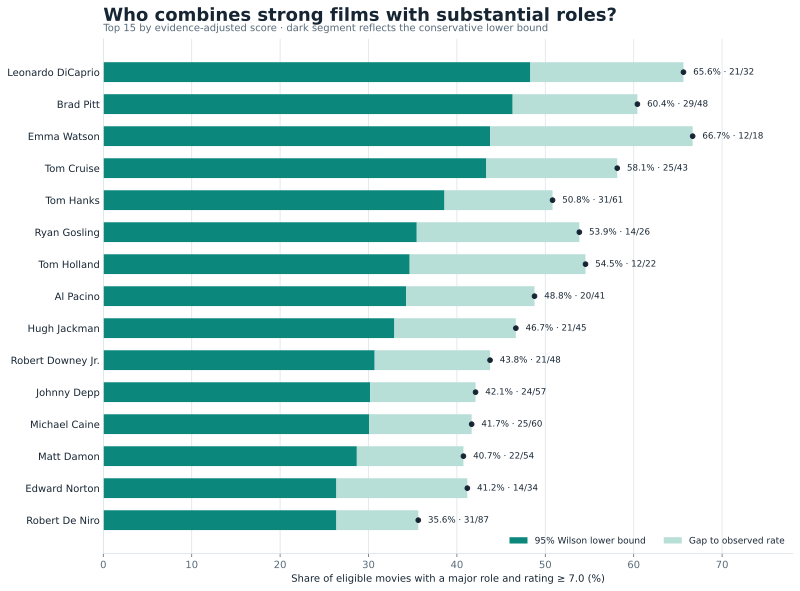
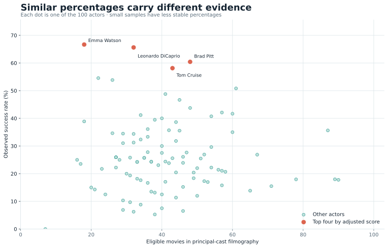
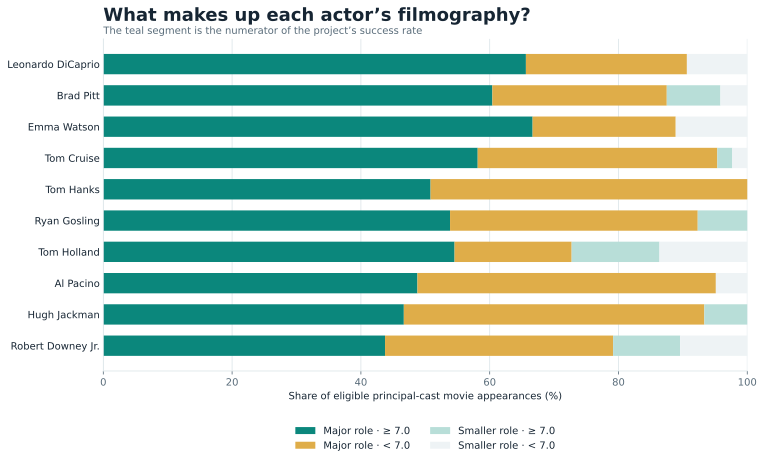
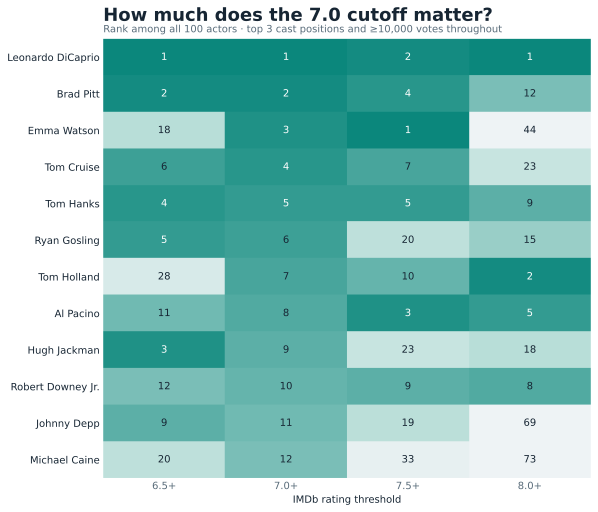

# Which movie actors land the most major roles in highly rated films?

A reproducible analysis of 100 prominent actors and actresses using IMDb's [non-commercial datasets](https://data.imdb.com/non-commercial-datasets/). The question is deliberately specific: **what fraction of an actor's eligible movies both rate at least 7.0 on IMDb and place that actor among the first three credited cast members?**

In the October 7, 2026 snapshot, **Emma Watson has the highest observed percentage: 12 of 18 films, or 66.67%**. **Leonardo DiCaprio leads the evidence-adjusted ranking: 21 of 32 films, or 65.63%**, with a 48.31% Wilson lower bound. The difference matters because percentages from smaller filmographies are less stable.

| Evidence-adjusted rank | Actor | Successful / eligible films | Observed rate | 95% Wilson lower bound |
| ---: | --- | ---: | ---: | ---: |
| 1 | Leonardo DiCaprio | 21 / 32 | 65.63% | 48.31% |
| 2 | Brad Pitt | 29 / 48 | 60.42% | 46.31% |
| 3 | Emma Watson | 12 / 18 | **66.67%** | 43.75% |
| 4 | Tom Cruise | 25 / 43 | 58.14% | 43.33% |
| 5 | Tom Hanks | 31 / 61 | 50.82% | 38.60% |

These are results for the cohort and filters below. IMDb's ratings and vote counts change, so a new download can change the table.

## See the results

### The leading actors

The dark portion is each actor's conservative Wilson lower bound. The full bar and dot show the observed percentage; the label gives successful films divided by eligible films.



### Percentage versus sample size

Every dot represents one of the 100 actors. Emma Watson has the highest raw rate, while DiCaprio combines a nearly equal rate with more eligible movies. The highlighted four lead the evidence-adjusted ranking.



### What the percentage contains

A film can land in one of four groups: major or smaller role, crossed with high or lower rating. Only the teal segment contributes to the headline success rate. This makes the denominator and exclusions visible.



### Does the 7.0 threshold change the answer?

The cells show evidence-adjusted rank among all 100 actors if the rating cutoff is moved from 6.5 to 8.0 while the rest of the method stays fixed. Darker cells are higher ranks. The figure uses the same locally generated movie-credit rows as the main analysis.



## Method

The project downloads four official IMDb files. `title.basics` identifies movies and their titles; `title.ratings` supplies weighted average ratings and vote counts; `title.principals` supplies principal cast credits and ordering; `name.basics` supplies actor names. DuckDB joins the compressed TSVs directly, so the files do not have to be expanded into a large local database.

1. Keep `titleType = movie`, `isAdult = 0`, and `numVotes ≥ 10,000`. This snapshot has **12,622 eligible movie titles** across the full IMDb dataset.
2. For each movie, keep principal-credit rows whose category is `actor` or `actress`. Rank those rows by IMDb's `ordering` field. A **major role** is cast rank 1, 2, or 3. This is a billing proxy, not measured screen time or narrative importance.
3. Build a reproducible cohort: among performers with at least five eligible movies, select the 100 whose eligible principal-cast movie credits have the largest **sum of movie vote counts**. This is an audience-exposure measure. It is not IMDbPro's STARmeter chart.
4. Mark a credit successful when cast rank is at most 3 **and** the movie's IMDb rating is at least 7.0. Count each eligible movie once per actor.
5. Compute `success rate = successful movies / all eligible movies for that actor`. The primary ranking uses the **95% Wilson lower confidence bound** for that fraction; `raw_rank` separately ranks the literal percentages.

The Wilson score treats each eligible movie as a success/failure observation. It is a descriptive way to downweight small samples, not a claim that movies are independent random draws. The analysis also reports `major_role_hit_rate_pct` (high-rated major roles divided by all major roles) and `high_rated_major_share_pct` (high-rated major roles divided by all high-rated appearances), which answer different questions.

| Setting | Default | CLI flag |
| --- | ---: | --- |
| High-rating threshold | 7.0 | `--rating-threshold` |
| Minimum movie votes | 10,000 | `--min-votes` |
| Major-role cast positions | First 3 | `--major-cast-size` |
| Cohort size | 100 | `--top-n` |
| Minimum eligible movies for automatic cohort | 5 | `--min-movies` |

## Reproduce the analysis

Requires Python 3.10+, several gigabytes of free disk space, and an internet connection for the IMDb downloads. From this folder:

```powershell
python -m venv .venv
.venv\Scripts\Activate.ps1
python -m pip install -e ".[plots,dev]"

imdb-actor-success demo
imdb-actor-success download --data-dir data
imdb-actor-success analyze --data-dir data --output-dir results
imdb-actor-success plots --results-dir results --output-dir docs/figures
python -m pytest -q
```

On macOS or Linux, activate the environment with `source .venv/bin/activate`. The fictional `demo` takes seconds; the real download is about 1.3 GB compressed and the analysis needs additional temporary disk space.

The local `results/` directory contains:

- `leaderboard.csv`: all 100 actor-level measures, with raw and adjusted ranks.
- `movie_credits.csv`: the film-level evidence behind every numerator and denominator.
- `report.md`: a readable top-20 report.
- `summary.json`: parameters, winners, generation time, and input-file metadata.

Run a different scenario, for example:

```powershell
imdb-actor-success analyze --data-dir data --output-dir results `
  --rating-threshold 7.5 --min-votes 25000 --major-cast-size 2 --min-movies 10
imdb-actor-success plots --results-dir results --output-dir docs/figures
```

If you have a legitimately obtained list of IMDb name IDs, supply a CSV with `nconst,rank` columns and `--people-csv people.csv` to use that cohort instead of the audience-exposure rule.

## Interpretation and limits

IMDb's `title.principals` file contains **principal credits, not complete filmographies**. A film in which someone has only a minor credit outside that file will not enter their denominator. The project therefore answers a question about **eligible principal-credit appearances**, not every movie the person has ever appeared in. Likewise, cast order is an imperfect stand-in for character importance, and the 10,000-vote floor favors widely seen films. Recent careers and some film industries may be represented differently from older or English-language studio careers.

The top-100 cohort is based on film-vote exposure, which tends to favor people in popular movies. It should not be described as IMDb's official top 100 or as a measure of acting quality. The ranking is sensitive to the cohort, vote floor, role definition, and rating cutoff; the sensitivity figure shows one slice of that dependence.

## Repository and data use

The code, this README, and the aggregate SVG figures are intended for the GitHub repository. The four downloaded IMDb files and the detailed generated CSV and JSON outputs remain in `data/` and `results/` locally and are excluded by `.gitignore`. A clone can regenerate them with the commands above.

IMDb allows local copies of its [non-commercial datasets](https://data.imdb.com/non-commercial-datasets/) for personal, non-commercial use and restricts [website scraping and republication of movie databases](https://help.imdb.com/article/imdb/general-information/can-i-use-imdb-data-in-my-software/G5JTRESSHJBBHTGX). Review those terms for your own use of the data.

```text
Information courtesy of
IMDb
(https://www.imdb.com).
Used with permission.
```
